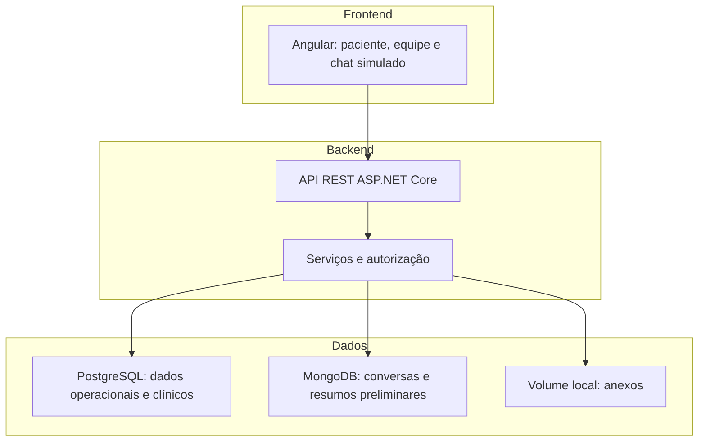
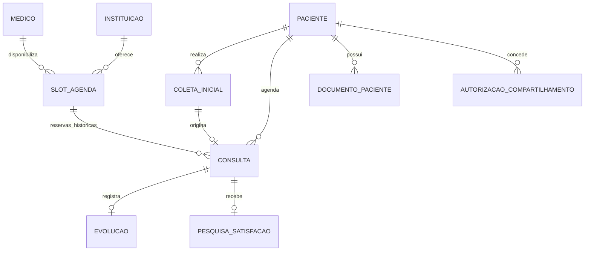

# POC acadêmica: triagem inicial e agendamento

## 1. Instrução ao agente

Implemente uma POC local, demonstrável, simples e em português brasileiro. Este arquivo define o escopo e os critérios de aceite. Priorize um fluxo completo funcionando. Não transforme a atividade em um produto hospitalar de produção. Entregue código, README com execução, dados fictícios, documentação de arquitetura, entidades, permissões, API e roteiro de demonstração. Não publique nem integre serviços externos reais.

Decisões confirmadas: Angular; backend .NET; PostgreSQL e MongoDB obrigatórios; chatbot guiado determinístico, sem LLM; WhatsApp e e-mail simulados na aplicação.

Premissas ajustáveis: execução local; duas instituições fictícias no mesmo sistema; consulta de 30 minutos em slots predefinidos; uma especialidade por médico; agendamento somente após validação da coleta pelo enfermeiro. Não bloquear a implementação por escolhas cosméticas.

## 2. Problema e recorte

A jornada de atendimento apresenta preenchimento repetido, cadastro manual, conferência de documentos, autorização do convênio, espera entre setores, falta de informações para o médico, lentidão do prontuário, pagamento, emissão de documentos, retorno e comunicação fragmentada.

A POC demonstra redução do retrabalho de coleta, organização da agenda, acesso contextual ao histórico e comunicação após atendimento. Não prometer redução de tempo sem medição. Convênio, pagamento, OCR, prontuários externos e emissão de documentos oficiais ficam fora do escopo.

## 3. Funcionalidades obrigatórias

1. Login com contas fictícias e autorização no backend.
2. Cadastro único de paciente; reutilizar dados nas próximas consultas.
3. Chat web identificado como WhatsApp simulado. Coletar queixa, duração, alergias e medicamentos relatados; usar perguntas predefinidas e gerar resumo por template, sem IA.
4. Fila do enfermeiro: ler conversa e resumo, corrigir informações, validar coleta ou encaminhar para avaliação presencial. Não gerar classificação clínica autônoma.
5. Lista de horários por instituição/médico/data; paciente escolhe conforme sua disponibilidade. Atendente pode agendar em nome do paciente.
6. Médico acessa consultas e dados autorizados, registra uma evolução textual e conclui atendimento.
7. Upload e download de PDF/JPEG/PNG, com metadados e vínculo ao paciente. Histórico longitudinal de evoluções e documentos.
8. Compartilhamento entre as duas instituições fictícias por autorização explícita do paciente, revogável; sem conexão com sistemas reais.
9. Ao concluir consulta, gerar convite de satisfação na caixa simulada. Formulário com nota de 1 a 5, percepção após atendimento (melhor/igual/pior/prefiro não responder) e comentário opcional. Não interpretar como avaliação clínica.
10. Painel administrativo simples: consultas por status, coletas pendentes e média das notas respondidas.

## 4. Perfis e permissões

| Perfil | Permitido | Restrição |
| --- | --- | --- |
| Paciente | Próprio cadastro, chat, agenda, documentos, histórico, autorizações e pesquisa | Apenas seus dados |
| Atendente | Cadastro e contato, slots, agendar/cancelar, status operacional | Sem conversa de sintomas, resumo, evoluções ou conteúdo de documentos clínicos |
| Enfermeiro | Coletas da sua instituição, conversa e resumo, correção e validação | Não escreve evolução médica nem administra usuários |
| Médico | Próprias consultas; histórico/documentos de pacientes vinculados a seus atendimentos e autorizados | Não acessa todos os pacientes por ser médico |
| Desenvolvedor/admin técnico | Contas, vínculos, configuração não sensível e saúde dos serviços | Sem acesso clínico automático; logs não exibem sintomas/documentos |

Enfermeiro é um perfil adicional necessário para a validação humana. Desenvolvedor representa administração técnica na POC. O atendente usa o painel administrativo operacional. Credenciais de infraestrutura não são uma permissão funcional da aplicação.

Permissões devem ser verificadas no backend, inclusive em download e consultas por ID. Ocultar botões no Angular não substitui autorização. Usuários internos têm vínculo com uma instituição; médicos também têm pacientes vinculados por consulta. Profissionais da instituição de origem acessam apenas conforme função e vínculo; outra instituição requer autorização ativa do paciente. Revogar bloqueia novos acessos pelo sistema, mas não desfaz downloads anteriores.

## 5. Arquitetura e tecnologias

Usar monólito modular: uma SPA Angular e uma API ASP.NET Core. Uma única aplicação backend com Controllers, Services e acesso a dados. DTOs explícitos. Evitar microserviços, mensageria, CQRS, event sourcing, Kubernetes, RAG, banco vetorial e frameworks de agentes.

| Parte | Escolha |
| --- | --- |
| Frontend | Angular com formulários e roteamento; biblioteca visual simples opcional |
| Backend | ASP.NET Core Web API em versão LTS suportada no ambiente |
| Relacional | PostgreSQL + EF Core/Npgsql e migrations |
| Documental | MongoDB com driver oficial .NET |
| Autenticação | ASP.NET Core Identity com JWT, sem fluxo de refresh na POC |
| Chatbot simulado | Máquina de estados simples no backend, perguntas fixas e resumo por template |
| Execução | Docker Compose para os bancos; API/SPA locais |
| Documentação | OpenAPI e README; Mermaid para diagramas |

Fixar versões compatíveis no projeto. Não depender de serviços pagos. Não instalar Ollama, modelos de IA nem SDKs de LLM. Toda a demonstração funciona sem chamadas externas.

## 6. Entidades e relacionamentos

PostgreSQL é a fonte de verdade dos dados abaixo. Usar UUIDs, datas em UTC e conversão para America/Sao_Paulo na interface.

| Entidade | Campos principais e relações |
| --- | --- |
| Usuario | Identity, nome, perfil, instituicaoId opcional |
| Instituicao | id, nome; possui usuários e slots |
| Paciente | id, usuarioId único, nome, nascimento, telefone/e-mail fictícios |
| Medico | id, usuarioId único, especialidade; possui slots |
| SlotAgenda | id, medicoId, instituicaoId, inicioUtc, fimUtc; intervalo predefinido |
| ColetaInicial | id, pacienteId, instituicaoId, status, conversaId, resumoValidado, enfermeiroId, validadoEm |
| Consulta | id, pacienteId, slotId, coletaId, status, criadaEm; no máximo uma consulta ativa por slot |
| Evolucao | id, consultaId único, medicoId, texto, criadaEm |
| DocumentoPaciente | id, pacienteId, instituicaoOrigemId, nomeOriginal, tipo, tamanho, chaveArquivo, criadoEm |
| AutorizacaoCompartilhamento | id, pacienteId, instituicaoOrigemId, instituicaoDestinoId, criadaEm, revogadaEm |
| PesquisaSatisfacao | id, consultaId único, nota, percepcao, comentario, respondidaEm |
| NotificacaoSimulada | id, pacienteId, consultaId, canal, finalidade, texto, criadaEm |

MongoDB: coleção `conversas`, documento com `_id` (UUID textual), `pacienteId`, `coletaId`, `mensagens[]` (papel, conteúdo, data), `resumoPreliminar`, `etapaAtual`, `versaoRoteiro` e timestamps. Limitar mensagens/tamanho por sessão para manter o documento pequeno. O vínculo entre bancos é lógico por UUID, sem foreign key entre bancos. Não duplicar agenda/prontuário em MongoDB. O resumo validado pelo enfermeiro fica em PostgreSQL; o resumo automático por template e a conversa ficam em MongoDB.

Não usar transação distribuída. Criar primeiro coleta pendente no PostgreSQL; inicializar documento MongoDB de forma idempotente por coletaId. Se MongoDB falhar, exibir erro recuperável e permitir repetir sem criar outra coleta. Coleta só é finalizada quando conversa e resumo necessário estão disponíveis; o resumo é gerado por template a partir dos campos preenchidos. IDs são gerados pelo backend.

## 7. Regras e estados

- Coleta: EmColeta → PendenteValidacao → Validada ou EncaminhadaPresencial. Somente enfermeiro decide o resultado; registrar responsável e horário. EncaminhadaPresencial não libera agendamento automático.
- Consulta: Agendada → EmAtendimento → Concluida; Agendada pode virar Cancelada. Conclusão exige evolução. Validar transições no backend.
- Agendamento: coleta validada do mesmo paciente/instituição; slot futuro; não existe consulta ativa no slot nem conflito de horário do paciente. Validar relação médico/instituição.
- Usar slots fixos sem sobreposição por médico. Constraint/índice único parcial no PostgreSQL impede duas consultas não canceladas para o mesmo slot. Proteger também concorrência de reservas do mesmo paciente, por transação e lock da linha do paciente antes da verificação de sobreposição. Conflito retorna 409.
- Cancelamento libera o slot. Sem lista de espera ou otimização automática. Reagendamento pode ser cancelamento seguido de nova reserva.
- Compartilhamento cobre dados da instituição de origem para instituição de destino escolhida; exigir vínculo do profissional com consulta do paciente. Downloads passam pela API; arquivos não ficam em diretório público.
- Conclusão cria uma pesquisa e convites simulados WhatsApp/e-mail uma única vez, na mesma transação PostgreSQL. Sem scheduler e sem envio real. Resposta depende de autenticação do próprio paciente e consulta concluída.
- Upload limitado a 5 MB, com validação de extensão, tipo e assinatura básica; nome interno gerado pelo servidor, sem caminhos fornecidos pelo usuário. Para a demonstração, usar somente anexos fictícios fornecidos pelo projeto.

## 8. Chatbot simulado, sem LLM

Implementar um chat guiado determinístico no backend, com aparência de WhatsApp e aviso “Canal simulado — coleta guiada sem IA”. Não usar Ollama, modelos de linguagem, NLP, RAG ou serviços externos. A aplicação deve executar integralmente offline após instalação das dependências.

O bot faz coleta prévia e prepara um resumo para revisão humana. Não diagnostica, prescreve, determina prioridade clínica ou libera atendimento por conta própria. Não implementar protocolo de triagem clínica real.

Roteiro fixo, uma pergunta por vez:

1. Confirmar dados cadastrais já existentes, sem pedir novamente todos os dados.
2. Selecionar instituição para atendimento.
3. Perguntar a queixa principal, em texto livre.
4. Perguntar há quanto tempo ocorre, em texto livre.
5. Perguntar alergias: sim/não/não sei; se sim, solicitar descrição.
6. Perguntar medicamentos em uso: sim/não/não sei; se sim, solicitar descrição.
7. Perguntar se deseja acrescentar alguma informação, com opção de pular.
8. Exibir resumo para conferência; permitir editar campos ou confirmar envio ao enfermeiro.

Usar botões para escolhas fechadas e campos de texto com limites para respostas abertas. Texto livre é armazenado literalmente e exibido com escape, sem tentar interpretar significado clínico. O backend controla etapas, valida respostas e permite retomar a conversa após recarregar a página. Repetição da mesma requisição não pode avançar duas etapas: usar identificador de mensagem do cliente e controle de versão da etapa.

Gerar resumo por template: “Queixa relatada: {queixa}. Duração relatada: {duracao}. Alergias relatadas: {alergias}. Medicamentos relatados: {medicamentos}. Observações: {observacoes}.” Informação ausente deve aparecer como “não informado”; não inventar dados nem chamar o resultado de resumo de IA. O enfermeiro revisa, corrige e registra a versão validada.

Perguntas fora do roteiro recebem resposta fixa: “Nesta demonstração, consigo coletar informações para a equipe. Para outras dúvidas, solicite atendimento humano.” Exibir opção permanente para solicitar avaliação presencial e indicação fixa de procurar serviço de emergência em situação urgente; não classificar urgência por palavras-chave. Usar somente cenários fictícios, sem validar segurança clínica.

Simular WhatsApp e e-mail com mensagens persistidas e uma caixa de entrada interna. Não exigir número de telefone real, credenciais de provedor, webhook, SMTP ou envio externo. Cadastro, agenda, persistência, permissões, revisão humana e pesquisa devem ser implementados de verdade; apenas os canais de comunicação são simulados. Convites da pesquisa usam textos fixos e abrem o formulário interno.

## 9. API REST principal

Prefixo `/api`. Usar DTOs; nunca aceitar papel, pacienteId ou autoria sem conferir permissões. Listagens paginadas. Retornar 400 para entrada inválida, 401 sem autenticação, 403 para acesso negado, 404 para recurso inexistente e 409 para conflito. Falhas de dependência retornam erro explícito e recuperável. Documentar payloads e autorização em OpenAPI.

| Método e rota | Uso / perfil |
| --- | --- |
| POST /auth/login | Login de contas seed |
| GET /auth/me | Usuário atual |
| GET /instituicoes | Instituições disponíveis |
| GET /medicos?instituicaoId= | Profissionais para agenda |
| GET /pacientes; POST /pacientes | Cadastro/listagem operacional pelo atendente |
| GET /pacientes/{id}; PATCH /pacientes/{id} | Próprio cadastro ou dados operacionais pelo atendente |
| POST /coletas | Iniciar coleta; paciente autenticado |
| GET /coletas/{id} | Paciente autor ou equipe clínica autorizada |
| POST /coletas/{id}/mensagens | Resposta do paciente; próximo passo do roteiro fixo |
| POST /coletas/{id}/finalizacao | Encaminhar para validação |
| GET /coletas?status=PendenteValidacao | Fila do enfermeiro na sua instituição |
| PUT /coletas/{id}/validacao | Enfermeiro registra resultado e resumo corrigido |
| GET /slots?medicoId=&data= | Slots disponíveis |
| POST /slots | Administração de agenda pelo atendente; validar instituição |
| GET /consultas | Listagem filtrada pelas permissões |
| POST /consultas | Reserva pelo paciente ou atendente |
| PATCH /consultas/{id}/status | Cancelamento ou início, conforme perfil e estado |
| PUT /consultas/{id}/evolucao | Médico responsável salva evolução |
| POST /consultas/{id}/conclusao | Médico conclui e gera pesquisa/convites |
| GET /pacientes/{id}/historico | Paciente ou profissional clínico autorizado |
| POST /pacientes/{id}/documentos | Paciente ou médico autorizado anexa arquivo |
| GET /pacientes/{id}/documentos | Listagem autorizada |
| GET /documentos/{id}/arquivo | Download autorizado pelo backend |
| GET /pacientes/{id}/autorizacoes | Próprio paciente |
| POST /pacientes/{id}/autorizacoes | Paciente concede compartilhamento |
| DELETE /autorizacoes/{id} | Paciente revoga; manter registro |
| GET /notificacoes | Caixa simulada do paciente |
| GET /consultas/{id}/pesquisa | Próprio paciente |
| PUT /consultas/{id}/pesquisa | Resposta única do paciente |
| GET /dashboard | Indicadores operacionais agregados do atendente |
| GET /admin/usuarios; POST /admin/usuarios | Admin técnico gerencia contas fictícias |
| GET /health | Saúde básica sem detalhes sensíveis |

## 10. Telas e fluxo demonstrável

Uma SPA com navegação por perfil, sem aplicativos separados:

- Login e identificação visível da instituição/perfil.
- Paciente: cadastro, chat, slots, consultas, histórico/documentos, autorizações e mensagens/pesquisa.
- Atendente: painel operacional, cadastro, agenda e consultas.
- Enfermeiro: fila e detalhe com conversa, proposta de resumo e formulário de validação.
- Médico: agenda, detalhe da consulta, histórico permitido e evolução/conclusão.
- Admin técnico: usuários e estado das dependências.

Roteiro: paciente inicia coleta na Clínica A, responde às perguntas guiadas, envia para validação; enfermeiro corrige e valida; paciente escolhe horário; médico abre consulta com resumo, anexo e histórico, registra evolução e conclui; paciente abre convite simulado e responde pesquisa. Para demonstrar compartilhamento, paciente autoriza Clínica B e médico B com consulta vinculada acessa histórico de A. Depois de revogar, o mesmo acesso é negado.

## 11. Entrega e implementação incremental

1. Estrutura API/SPA, bancos, migrations, seeds e login.
2. Agenda e consultas com bloqueio de reservas duplicadas.
3. Coleta guiada, persistência em MongoDB, roteiro determinístico e validação humana.
4. Evolução, documentos e compartilhamento autorizado.
5. Pesquisa e caixa simulada; painel básico.
6. Verificação do roteiro e documentação final.

Dados seed: duas instituições, dois médicos (um por instituição), enfermeiro e atendente por instituição, dois pacientes e um admin técnico; slots futuros gerados em relação à data de execução; contas e senhas exclusivamente de demonstração. Um cenário concluído com histórico/anexo e um cenário novo para executar o fluxo.

Entregar README com pré-requisitos, versões, comandos, variáveis em `.env.example` sem segredos, migrations/seeds, reset dos dados e troubleshooting. Configurar volumes para bancos/anexos. Não exigir GPU nem instalação de modelos de IA.

Entregar `docs/arquitetura.md`, `docs/permissoes.md`, `docs/modelo-dados.md`, `docs/fluxos.md` e documentação REST/OpenAPI. Documentar simplificações e indisponibilidade de dependências. Não afirmar integração WhatsApp real, interoperabilidade hospitalar, validade clínica ou conformidade legal de produção.

## 12. Critérios de aceite

- Projeto sobe seguindo README e sem serviço pago.
- Chat guiado em português percorre o roteiro, gera resumo por template e permite retomar a sessão; conversa persiste em MongoDB e aparece ao enfermeiro.
- Sem validação humana, agendamento é recusado no backend.
- Dois pedidos concorrentes para o mesmo slot produzem exatamente uma reserva e um conflito; paciente também não pode ter horários sobrepostos.
- Consulta médica mostra resumo validado e histórico autorizado; conclusão gera pesquisa e convites uma única vez.
- Atendente e admin técnico recebem acesso negado aos dados clínicos e downloads mesmo chamando API diretamente.
- Paciente não acessa dados de outro paciente alterando IDs.
- Médico B precisa de vínculo com consulta e autorização ativa para acessar dados originados em A; revogação bloqueia novo acesso.
- Documento fictício pode ser anexado e baixado por usuário autorizado.
- Paciente responde sua pesquisa uma única vez; indicadores consideram apenas respostas recebidas.
- Perguntas fora do roteiro recebem resposta fixa; respostas não são apresentadas como IA. Reenvio de mensagem não duplica respostas nem avança etapas indevidamente.
- Existem verificações de integração focadas em autorização, concorrência de agenda, estados e idempotência de conclusão. Evitar testes que apenas repetem getters/DTOs.
- Todos os entregáveis solicitados aparecem na documentação; simulações estão identificadas na interface.

## 13. Referências técnicas

- ASP.NET Core: https://learn.microsoft.com/aspnet/core/
- Angular: https://angular.dev/
- PostgreSQL: https://www.postgresql.org/docs/
- MongoDB, modelagem: https://www.mongodb.com/docs/manual/data-modeling/

As escolhas de arquitetura e escopo deste documento são propostas para esta atividade; as referências apoiam o uso das tecnologias, não validam o sistema como solução clínica.
